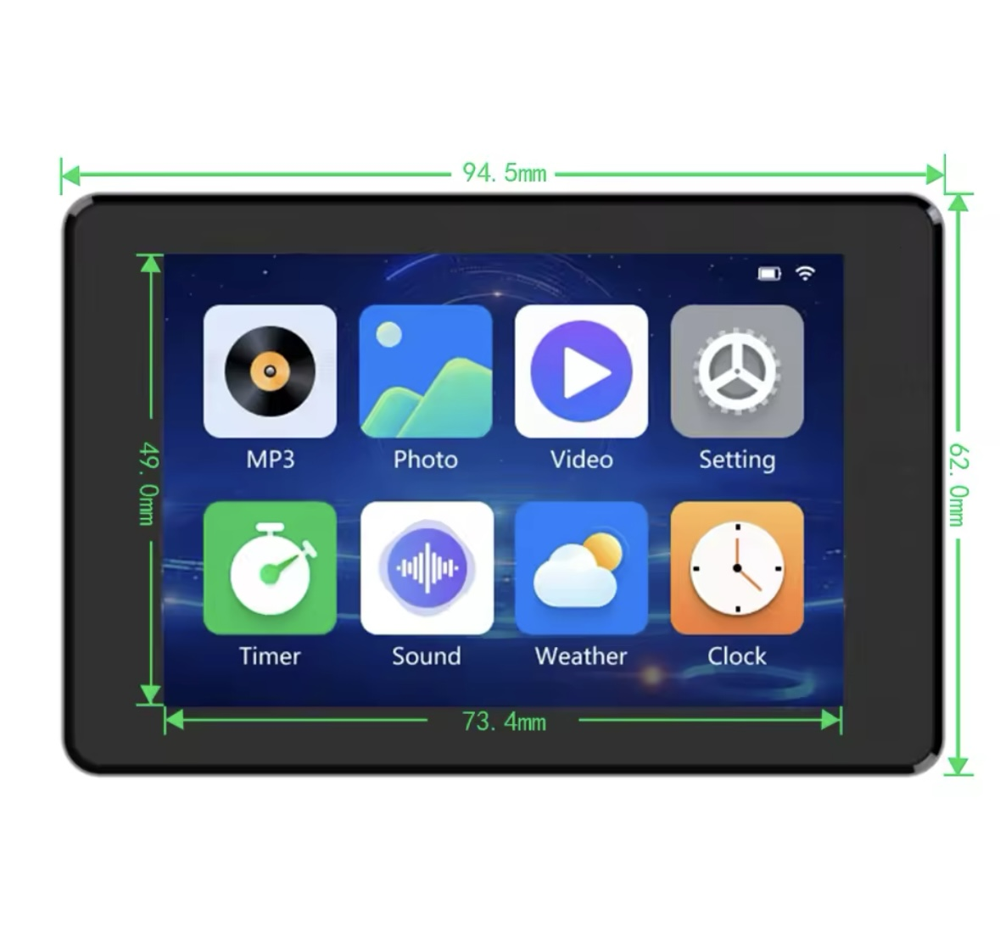

# JC3248W535 ESP-IDF + LVGL base project

A minimal, working starting point for the Guition **JC3248W535** 3.5" touch display board
(ESP32-S3, 320×480 AXS15231B QSPI panel, I2C capacitive touch, 16 MB flash, 8 MB PSRAM).

It brings up the display, touch, backlight and LVGL, shows a starter screen ("Let's Build" in the ten most
spoken languages), and nothing else, so you can build your own app on top of it.



- PlatformIO + ESP-IDF 5.2 (`espressif32@6.6.0`)
- LVGL 8.4.0 (pulled automatically via `lib_deps`)
- Uses the full 16 MB flash: two 6.25 MB OTA app slots + 3.4 MB data partition
- Firmware is ~575 KB, so there is plenty of room for your app

## Build and flash

Install [PlatformIO](https://platformio.org/install) (VS Code extension or CLI), connect the board over USB, then:

```bash
pio run -t upload -t monitor
```

The upload port is auto-detected. On Linux, if the port can't be opened, install the
[PlatformIO udev rules](https://docs.platformio.org/en/latest/core/installation/udev-rules.html).

## Project layout

| Path | What it is |
| --- | --- |
| `src/main.c` | `app_main()`: starts the display, sets rotation and screen-off timeout, calls `ui_init()` |
| `src/ui/` | Your UI. Starts with the "Let's Build" screen; replace it with your own screens or a SquareLine Studio export |
| `src/lv_conf.h` | LVGL configuration (fonts, widgets, logging) |
| `src/esp_bsp.c/.h` | Board support: pins, QSPI display, I2C touch, backlight PWM, LVGL lock |
| `src/esp_lcd_axs15231b.c/.h`, `src/esp_lcd_touch.c/.h` | AXS15231B panel and touch drivers |
| `src/lv_port.c/.h` | LVGL task, tick, flush and touch-input glue |
| `src/screen_off.c/.h` | Turns the backlight off after inactivity and wakes it on touch |
| `partitions.csv` | 16 MB OTA-ready partition table |
| `sdkconfig.defaults` | ESP-IDF settings (flash, PSRAM, CPU, size optimizations) |
| `tools/gen_lang_images.py` | Regenerates `src/ui/lang_images.c` (the starter screen's phrases) |

## Building your app

- **UI**: edit `src/ui/ui.c`, or replace `src/ui/` with a SquareLine Studio export (it provides the same
  `ui_init()`). Set SquareLine to LVGL 8.3.x, 16-bit color with byte swap, and 480×320 for the default rotation.
- **Calling LVGL from your own tasks**: wrap LVGL calls in `bsp_display_lock(0)` / `bsp_display_unlock()`.
  LVGL timers and event callbacks already run with the lock held.
- **Rotation / screen-off timeout**: `APP_DISPLAY_ROTATION` and `APP_SCREEN_OFF_MS` at the top of `src/main.c`
  (screen-off is disabled by default; set e.g. `60000` to turn the backlight off after a minute without touch).
- **Backlight**: `bsp_display_brightness_set(0..100)`, `bsp_display_backlight_on()` / `_off()`.
- **Fonts and widgets**: toggle them in `src/lv_conf.h`. Fonts and widgets you never reference are
  dropped at link time.
- **Non-Latin text**: LVGL 8 can't shape scripts like Devanagari, Bengali or Arabic, so the starter screen
  pre-renders them with HarfBuzz into small alpha images (`tools/gen_lang_images.py`, needs Pillow with raqm
  and the Noto fonts). Use the same approach, or LVGL fonts made with `lv_font_conv` for simpler scripts.
- **WiFi, BLE, NVS, filesystems**: just use the ESP-IDF APIs. Nothing is pre-initialized, so you only pay for what you use.

## Changing ESP-IDF settings

`sdkconfig.defaults` is the source of truth. PlatformIO generates `sdkconfig.jc3248w535` from it on the
first build (that file is git-ignored). After editing the defaults, delete the generated file so it is
regenerated, or use `pio run -t menuconfig` for one-off experiments.

## Pins

Used by this project:

| Function | GPIO |
| --- | --- |
| LCD QSPI CS / CLK | 45 / 47 |
| LCD QSPI D0–D3 | 21, 48, 40, 39 |
| LCD TE (tearing) | 38 |
| Backlight (PWM) | 1 |
| Touch I2C SDA / SCL | 4 / 8 |

On the board but not initialized here:

| Function | GPIO |
| --- | --- |
| microSD (SPI) CS / CLK / MOSI / MISO | 10 / 12 / 11 / 13 |
| Speaker amp (I2S) LRCLK / BCLK / DATA | 2 / 42 / 41 |
| Battery voltage (ADC) | 5 |
| Header P2 | 5, 6, 7, 15, 16, 46, 9, 14 |
| Headers P3 / P4 | 17, 18 |

Full details: [GPIO pinout](docs/GPIO_pinout.jpg), [ESP32 schematic](docs/ESP32_schematic.jpg),
[power schematic](docs/Power_schematic.jpg), [specifications](docs/JC3248W535%20Specifications-EN.pdf)
and the manufacturer's [getting started guide](docs/Getting%20started%20JC3248W535.pdf).

## Memory layout

| Partition | Offset | Size |
| --- | --- | --- |
| nvs | 0x9000 | 20 KB |
| otadata | 0xE000 | 8 KB |
| app0 (ota_0) | 0x10000 | 6.25 MB |
| app1 (ota_1) | 0x650000 | 6.25 MB |
| storage (data) | 0xC90000 | 3.4 MB |

The frame buffer (320×480×2 bytes) lives in PSRAM, which leaves the internal RAM free for your code.

## Credits

Based on the manufacturer's DEMO_LVGL package and the PlatformIO port by NorthernMan54.
Display, touch and LVGL port code is from Espressif (Apache-2.0); LVGL is MIT licensed.
